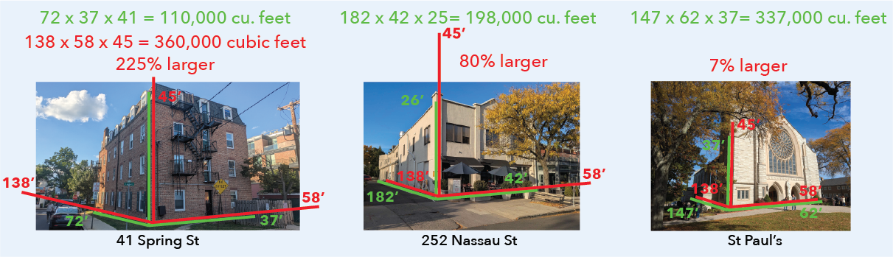
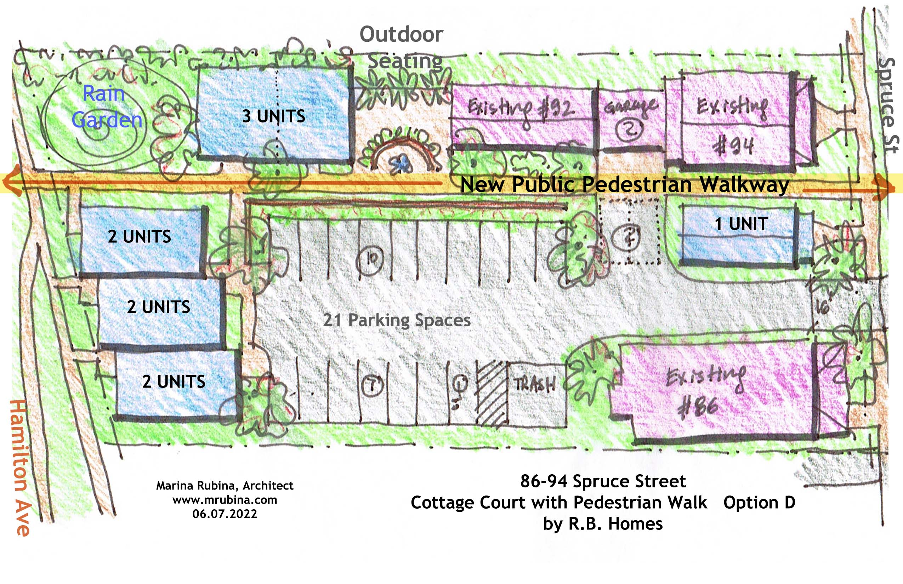

# How Barsky Got His Monster

{: .text-center }

*Marina's Spruce Walk design (red), 138 × 58 × 45 feet, against three familiar Princeton buildings (green).*

## TL;DR

The largest building in the Tree Streets, by a wide margin, on what would be its densest lot, was squeezed into the Fourth Round plan barely two weeks after the developer first pitched it. Nothing in the 2023 Master Plan or its reexamination contemplated anything like it. City staff and elected officials passed up every opportunity to engage the neighborhood, and described the project to their colleagues and the public in ways the record contradicts. Meanwhile, the owner had spent years ignoring the conditions of its 2017 approval — gravel, 21 spaces, no added runoff, shielded lighting — and the city never held them to it. The site was not “a mostly unused surface parking lot.” It was never supposed to be paved at all.

## Introduction

I want to acknowledge that very few people will care about this piece of writing. I am just a regular homeowner writing about a building project that predominantly affects our lot. Maybe you have formed an opinion of me – positive or negative – based on my objection to this project. Nonetheless, I am writing it because I think it reveals something of the mechanics of the city machine that has a larger message for how development has proceeded and may well continue to proceed. If you have a negative opinion about me, I think nevertheless this is not how you would envision development to happen. If you have no opinion whatsoever, you may come back to this next year or in a decade and find some mirror of your own experience. So, I am documenting it.

I started this project with basically no experience of city planning and real estate dynamics, other than being a broke-ass academic striving for an affordable first-time home for a decade in Princeton until landing one finally at age 45. I looked at every [teardown](docs/public_docs/201609_Princeton_Neighborhoods.pdf) from 2010-2020 as one more house a developer bought for all-cash that we could not.

We managed to buy a house from people who wanted us to buy it, because we would continue to garden and maintain the native plants down the lot. Next to my family and dearest friends, it’s the most important thing in my life.

Back in April, my neighbor Frank texted me an image from Town Topics saying that they had rezoned the parcel next door, a project neither of us was aware of. The rezoning would allow them to put a 45-foot wall along the entire fenceline, set back just 10 feet, casting the lot in shade for much of the day, and illuminating it at night. The monolith they built the zoning around would be multiples larger, by any metric, than any other building in the Tree Streets. This is the story of how they pulled it off.

# Pre-history – A lot that never was supposed to be paved

Barsky Enterprises filed a Notice Of Settlement with Eighty Six Spruce LLC, the previous owners, in September 2016 ([fig](fig/E.%20Mercer%20County%20Land%20Records.png)). While the property was under contract, the sellers went back to the Zoning Board for site plan approval and a variance. The building’s density (~23 units/ac) was, and remains, above the 4-20 units/acre the Master Plan land use map sets for the neighborhood; the Board had allowed it by use variance in 1990.

The applicants submitted a [site plan](docs/ryle_opra/201611_86_Spruce_Site_Plan.pdf) in November 2016, and the [town responded](docs/ryle_opra/201612_86_Spruce_SitePlanResponse.pdf) in December. The site plan prominently identifies [EXIST. GRAVEL PARKING LOT (TO REMAIN)](fig/A.%20Gravel%20Lot%20To%20Remain.png).

Land Use Engineer Jack West and Zoning Officer Derek Bridger [wrote a memo](docs/ryle_opra/201701_86_Spruce_ZBA_Eng_Report.pdf) in January 2017 regarding the site that is unexpectedly rich.

In it we find observations and recommendations:

- The existing parking lot is not paved and the applicant is not proposing to pave it. A variance is required. Staff is in support of the variance as paving the lot would increase the rate of runoff over the lot and have a negative effect on the adjoining property to the north.

- The proposed site plan provides 21 parking spaces where 15 are required by ordinance.

- Based on review of aerial photography from 1989 and surveys of the property from 1990, it appears that the parking lot was expanded approximately 20' further to the north.

- To compensate for the increase in the size of the parking lot, staff would recommend the installation of a rain garden.

- The applicant should install a bike rack.

- A sidewalk should be installed from the back of the parking lot to Hamilton Avenue.

- Currently there is an existing 500 watt spot light on the rear of the building, the applicant is proposing to replace the existing light with a 200 watt New Lantern Downturn fixture mounted 10' above grade.

On February 10, 2017, the then-owners distributed [a letter to neighbors](docs/ryle_opra/201702_86_Spruce_Noticing_Evidence.pdf) describing the variance they were requesting:

> We are seeking permission not to pave the gravel parking lot in an effort to minimize runoff. While the gravel lot requires a variance, paving the lot would cause water runoff issues that would not be an improvement to the area. The town staff supports keeping it gravel.

On February 22, 2017, the Zoning Board of Adjustment (ZBA) reviewed the engineering memo, the noticing evidence, and testimony of various people. [The resolution](docs/ryle_opra/201702_86_Spruce_ZBA_Resolution.pdf), memorialized March 22, 2017, includes the following statements:

- Mr. Bridger further testified that the staff supports the requested variance because paving the parking lot would increase the rate of runoff over the Property and have a negative impact on the adjoining property to the north.

- Mr. Chmielak … advised that the applicant will comply with staff recommendations and comments as set forth in the Bridger/West with the exception of the staff recommendation that the applicant install an exterior bicycle rack and install a sidewalk from the back of the parking lot to Hamilton Avenue.

- The applicant's proposed plantings along with the existing bumper blocks along the sides of the parking lot should serve to prevent any expansion of the parking area.

- The applicant has leased parking spaces for use by other than tenants as the number of parking spaces exceeds that required.

- NOW, THEREFORE, BE IT RESOLVED:

- A c (2) variance to permit a non paved parking area in exception to Section 17A-390 (b) to contain 21 parking spaces and minor site plan approval as set forth in the application and the project plans as presented, subject to the applicant's compliance with the following:

- (1.) Compliance with the comments and recommendations of Derek Bridger, Zoning Officer and John M. West, PE as set forth in Sections 4.0, 5.0 and 6.0 of their memo dated January 31, 2017.

- (4.) The applicant shall insure that the proposed development shall not cause increased runoff onto neighboring properties;

- (5.) The light source of any new exterior light fixtures may not be visible and such fixtures must be shielded to prevent light spillage onto surrounding properties;

On this last point, the initial site plan response similarly commented on the flood lights:

> Section 17A-365.1 of the Borough Code prohibits the use of building mounted flood lights.
> The plans should be revised or a variance requested.

In response to which the final site plan shows the flood light [TO BE REMOVED](fig/B.%20500W%20TO%20BE%20REMOVED.png) as well as its [specific replacement](fig/C.%20FLOODLIGHT%20ISOLINES.png):

In March 2017, Jack West [requires the site plan to be amended](docs/ryle_opra/201703_86_Spruce_Raingarden_Trees.pdf):

> 1. The rain garden should be elongated along the entire width of the parking lot.

*What makes everything above interesting:*

- Barsky Enterprises closed on the property in May 2017 ([deed](docs/ryle_opra/201705_86_Spruce_Deed.pdf)), two months after the ZBA memorialized its resolution. Barsky didn’t inherit a gravel lot by accident; he bought one whose approval said: gravel, 21 spaces, no added runoff, shielded lighting.

- In November 2019 the parking lot [is paved](fig/Q.%20Parking%202020.png)

  - No permit to pave the parking lot has emerged over multiple OPRA requests. The construction permit logs for [86](docs/wolf_opra/86_Spruce_Permit_Log.pdf), [88](docs/wolf_opra/88_Spruce_Permit_Log.pdf), [92](docs/wolf_opra/92_Spruce_Permit_Log.pdf) and [94](docs/wolf_opra/94_Spruce_Permit_Log.pdf) Spruce show nothing either.

- The only 2019 permit that touches the lot is Zoning Permit [Z19-712](docs/wolf_opra/201910_86_Spruce_DrivewayPermit.pdf), a $60 application signed off by Jack West nine days after it was received. It is for a driveway from the 86 Spruce lot to the new garages at 92-94 Spruce: “Pave Driveway per site plan attached dated 11/14/16.” The box for “Parking Area … greater than 400 SF ($200)” is left blank. And the site plan it cites as its authority is the gravel-lot plan, GRAVEL LOT label visible.

- The parking lot is 24 spaces, where the Board approved 21 (and required at least 15)

- The parking lot appears to be larger than the outline on the site plan.

- The neighbors wrote to Jack West concerned about runoff:

To which Jack West replied (11/19/2019):

> Vivian
>
> As you are aware there has always been, a large gravel parking lot at 86 Spruce, with no stormwater management, the Princeton stormwater ordinance considers gravel to be 100% impervious, and therefore the developer is allowed to pave. To be conservative we required the developer to installed [sic] a rain garden with an overflow that ties into the municipal system.

If you keep reading the [exchange](docs/ryle_opra/201911_86_Spruce_Neighbor_Emails.pdf) you can see a number of concessions that were agreed to (asphalt sloped to the center). If you check out the site today none appear to have been implemented. The rain garden doesn't extend the full width, there is no contour to funnel the water towards the raingarden, and there is visible erosion off the property.

*Mr West if you are reading this:
*
- Hadn’t you already co-written a memo to the ZBA saying the exact opposite of this? The issue with stormwater runoff is not simply impervious surface, but also speed. Why didn’t you share the memo and the resolution?

- Doesn’t several thousand square feet of disturbance require some kind of formal process, perhaps including a revised site plan, an engineering review, stormwater/runoff analysis, re-noticing the neighbors?

- Why did you say that you asked the developer to install a rain garden to address the paving, when in fact the rain garden was due to the expansion of the parking lot by 20’ over the previous ~25 years? Why did the rain garden plan not change in response to the parking lot?

- How did 21 spaces become 24?

*One last piece because it disturbs my sleep every night*

- The floodlight is still there, [illuminating the neighboring properties](fig/H.%20Light%20Spillage.jpg) and reflecting off the trash bins into my bedroom window

Mr West if you are reading this:

- We and the previous owners asked Barsky Property Management to please change the lighting and they refused. Now it turns out this lighting was never supposed to be there. Who is supposed to hold developers accountable that they do the things they were supposed to do?

# Interpretation

That is all the state of play before they rezoned the site. Our lots get runoff from the parking lot in heavy storms and the light spillage is annoying.

That all changes when we learn from [Town Topics](fig/S.%20Town%20Topics.jpg) that they rezoned the property next door and moreover the site plan is massive, because the very rationale that was used was that this was “an underutilized surface parking lot” ([HEFSP](docs/public_docs/202506_HEFSP.pdf)) ([AH-12 Ordinance](docs/appendix-a-ordinance.pdf)) ([June 25 transcript](docs/public_docs/20250625_PrincetonPlanningBoardTranscript.txt)) ([Feb 23 transcript](docs/public_docs/20260223_PrincetonCityCouncilTranscript.txt)). That’s a little cheeky when it was paved despite the 2017 variance and staff testimony that paving would increase runoff, was given more spaces than were needed or allowed (24, where 21 were approved and 15 required), and the only permit to emerge over multiple OPRAs is a $60 permit that cites the gravel-lot plan. Moreover, the [ZBA resolution](docs/ryle_opra/201702_86_Spruce_ZBA_Resolution.pdf) acknowledges that the lot owners used to lease out excess capacity, in a neighborhood that has a [notable deficit of parking](docs/public_docs/201712_NelsonNygaard-Parking-Study-Report.pdf). In short, it appears that Barsky created the very “Underused Parking Lot” that was used as a pretext for the development, which otherwise was not part of any master plan and deeply contradicts the master plan’s land use map.

And the parking lot is not even underused! On any given morning you can see it mostly full.

In addition, the path and bike racks that are now part of the sales features of this development were recommendations from city engineers at the time Barsky acquired the property in 2016/2017. A close reader would observe that the person that rejected the path and bike racks before the ZBA was the previous owner, not Barsky. However, a close reader would also have noticed that the attorney that represented the previous owner, [Chris Tarr of Stevens & Lee](docs/ryle_opra/201612_86_Spruce_SitePlanResponse.pdf), is also Barsky’s attorney. Why does the city keep framing as concessions (the rain garden, the path, the bike rack) those things that they could have gotten for free?

# Entr’acte

Circa 2022 I saw Marina Rubina over in that parking lot over my back fence. I know/knew Marina from renting space at Tiger Labs in 2015-2017 and generally support urban in-fill. I have probably reposted her NYT article on ADUs. So when she says she’s working on a project to put some ADUs at the bottom of the lot, I was positive.

On June 8, 2022, [Daniel Barsky writes to Justin Lesko, Derek Bridger and James Purcell](docs/wolf_opra/20220608_SpruceCottageCourt.pdf) with a design for a new development on the site, including a [design from Marina](docs/ryle_opra/202206_86_Spruce_Plan.jpg), copying Chris Tarr. In his words:

>“We understand that there will be quite a few variances involved but we think this is a good site to have a higher density application where the town can benefit from an additional 2 affordable units and a dedicated walkway to cut through from Spruce to Hamilton Ave.”

It is now appropriate to point out here that Chris Tarr is Marina’s attorney as well, and serves on the board of Princeton First Aid and Rescue with Mayor Mark Freda, a topic that arose as a potential conflict in conjunction with Mayor Freda’s presence on the Planning Board ([link](https://www.tapinto.net/towns/princeton/sections/government/articles/on-the-agenda-filling-two-important-seats-on-the-princeton-planning-board)).

This drawing was what was in my mind’s eye when I saw Marina over the fence. While I still expected to be noticed on the project, its scope didn’t offend me.

# Spruce Walk and the Fourth Round

The ball gets rolling in earnest on May 28th, 2025, with Chris Tarr reaching out to the town’s attorneys to schedule time for a [pitch on the Spruce Walk plan](docs/wolf_opra/20250528_InitialSprucePitch.pdf). They meet on May 30th, with drawings bearing the same date [spruceplan1](fig/spruceplan1.png), [spruceplan2](fig/spruceplan2.png). It is clear from the email thread that they are also submitting a project for 245 Nassau to the Fourth Round, and perhaps on the spur of the moment decided to add this, what Mia Sacks later called “a late inclusion to the fourth round”. The project went from 10 new units to 30 new units on a site we have already pointed out is above the density the Master Plan sets for the neighborhood. Instead of little townhouses, this is a monolithic apartment block that rivals the volume of some of the larger buildings downtown.

The Fourth Round Plan aka [Housing Element Fair Share Plan](docs/public_docs/202506_HEFSP.pdf) is published June 13, 2025, two weeks after the meeting. Some of the key text used to describe the site:

- One lot includes a duplex and the other contains a mostly unused surface parking lot. [p 67]

- _AW: this is not correct. On any given day the parking lot is mostly used (see above)._

- Six townhomes will be constructed to front along Hamilton Avenue. These homes will be similar in size and shape to the already-existing adjacent affordable townhome units. [p 67]

- _AW: this is not correct. There are three buildings in the plan. One one small building on Spruce, one large building with 3 units, and one very large building with 23 units. None resembles the affordable townhouses down the street._

- The property owner will provide a multi-use bike and pedestrian path through the middle of the site granted in perpetuity as an easement to the town. [p 67]

- _AW: this is not correct. The ordinance states only a path, not a bike path. Later, Barsky amended the plan such that the building fronting Spruce would overhang the path._

- The lots are currently zoned R-4, and will be rezoned to enable the proposed development to be constructed consistent with zoning, Residential Site Improvement Standards (RSIS) and all other applicable regulations. [p 68]

- _AW: this is not correct. The final zoning has just 0.425 parking places per unit, in other words 3 new slots for 30 new units:_

     _42 * 0.425 = 17.9_

- _The Spruce Walk design shows only 17 spaces total. The photo shows 15 cars there now. RSIS minimums are 1.9 spaces/unit for this unit mix (N.J.A.C. 5:21-4.14), and current utilization is ~1.3 spaces/unit. Furthermore, the parking lane is 22 ft, whereas RSIS dictates a 24 ft lane._

*Open Questions:*

- Who wrote this?

- On what basis was it stated that the site was a mostly unused surface parking lot?

- On what basis was it described that the site plan includes six townhomes?

- Why is the path described as a bike path when neither the June 2025 draft nor the adopted zoning requires a bike path? Barsky’s own November markup tried to add “bicycle” to the ordinance, and it was not adopted.

Walkable Princeton is the first to post on the plan on June 17 [link](https://walkableprinceton.com/2025/06/17/town-of-princeton-embraces-smart-growth-with-proposed-sites-for-new-affordable-housing/), then Tap Into Princeton on June 18th [link](https://www.tapinto.net/towns/princeton/sections/planning-and-zoning/articles/princeton-s-round-four-affordable-housing-plan-smart-growth-in-smart-places). Town Topics publishes the existence of the plan on June 25 [link](https://www.towntopics.com/2025/06/25/town-tackles-next-round-of-affordable-housing/), the same day as it has its public presentation and is voted upon. I am out of the country this entire period of time.

Our neighbor Pat DiMaio at 96 Spruce sees the article and joins the meeting to ask about the zoning. ([transcript](docs/public_docs/20250625_PrincetonPlanningBoardTranscript.txt))

>**David Cohen:** I’m glad you’re raising the question and it is timely. Part of what we’ll be doing, as Justin mentioned, is writing the ordinances that enable each of these developments to happen and buffering requirements are part of the ordinances. So we will definitely take note that it’s a concern of yours and make sure that that’s incorporated specifically into the zoning for that site.

What Mr Cohen didn't say is that the [zoning ordinance was already drafted](docs/appendix-e-draft-ordinance.pdf), because it was submitted to the court two days later, on June 27. But, the HEFSP version shared with the public did not include these ordinances, only the version that was submitted to the court.

*Mr Cohen if you are reading this:*

- Why didn’t you post the ordinances with the HEFSP text so residents could have read it at the time?

- Why didn’t you tell Ms. DiMaio in response to a direct question about zoning that the draft zoning was available and could be reviewed?

September 5, 2025, a [meeting with the Council’s Affordable Housing, Planning & Redevelopment Committee](docs/wolf_opra/20250905_FollowupMeeting.pdf), with Daniel and Roman Barsky, Marina Rubina, Chris Tarr, and city attorneys. They meet with the committee again on Friday, November 7, and on November 11th, Daniel Barsky writes to Justin Lesko with his [own redline of the zoning ordinance](docs/wolf_opra/20251111_BarskyRedlinedZoning.pdf). Justin forwards it that afternoon to councilmembers Mia Sacks and David Cohen, the town’s attorney, and staff. Note - at this point the existence of the zoning would only be known to someone who reviewed the submission to the court.

What did Barsky change?

- Narrowed the front yard requirement from buildings fronting “a public street” to buildings fronting Spruce Street.

- _AW: this would have opened up front-yard setbacks to honor the current condition on Hamilton Ave, where there are essentially no front yards._

- Struck minimum building separation fifteen (15) feet (Adopted: 5 ft (Feb 10 memo)).

- _AW: this would have opened up front-yard setbacks to honor the current condition on Wiggins, where there are essentially no front yards._

- Struck the building height “shall be three (3) stories” (Adopted: 45 ft, no story limit)

- _AW: In the 375 Terhune site, a Barsky entity applied for (and got) a variance to add a fourth floor to a site that was similarly zoned for 45 feet maximum height._

- Struck 0.55 off street parking space per dwelling => replaced with 0.33 parking space per unit (Adopted: 0.425, with up to 25% compact.)

- _AW: The fewer parking spaces are required, the more units can be built._

- Add: Parking garage aisle to be 20 feet

- _AW: Final ordinance is 22 feet. The state’s Residential Site Improvement Standards call for a 24-foot aisle for 90-degree parking (N.J.A.C. 5:21-4.16, Table 4.5), which is also what the town approved for this same lot in 2017._

- Struck the rear yard requirement for a landscaped buffer of not less than 5 feet.

- _AW: The 5 feet setback from the rear now has no landscape buffer._

*Since we are looking at the zoning itself, some open questions:*

- Is it normal for a developer to redline their own ordinance? Justin, it seems like the updated ordinance "combines what we discussed internally, what Daniel submitted, and what we discussed today." Did you ever think to ask any neighbors?

- Who wrote this zoning originally, and on what basis? The bulk standards bear no resemblance to the zoning for other AH developments in R4 districts, with a fraction of the parking, smaller unit sizes, little open space, and extreme density.

| | **AH-12** 86–94 Spruce | R-4B AH townhouses next door | AHO-3 457 Nassau | AH-7 375 Terhune |
|---|---|---|---|---|
| **Lot size** | 0.43 + 0.23 ac | 0.78 ac | ~0.76 ac | 2.34 ac |
| **Units** | 34 + 8 | 16 | 19 | 30 |
| **Density** | **79** / 35 du/ac | 20.5 du/ac | 25 du/ac | 12.8 du/ac |
| **Height** | 45 ft, no story cap | 40 ft / 3 stories | 35 ft | 45 ft townhouses / 35 ft apts |
| **Side yard** | 10 ft (perimeter only) | 15 ft (30 combined) | 20 ft | 35 ft to homes |
| **Rear yard** | 5 ft | 25 ft | 25 ft | lot-specific |
| **Parking / unit** | **0.425** | 1.5 | 1.3 | 1.5 (built ≈ 1.9) |
| **Buffer to neighbors** | 5 ft, side only | — | 15 ft | 15 ft + fence |
| **Open space required** | **none** | 600 sf/unit + 200 sf/room | none | none |
| **Impervious cover** | 75% | — | 70% | — |

On November 7, Barsky sends an [alternative plan](docs/wolf_opra/20251112_BarskyRevisedPlan.pdf), designed by Marina, which Justin circulates to council on November 12. This design puts four units on the Spruce-facing building, where previously there was one. This building has a narrow ground floor and an overhang over the path, with a narrow spacing to the existing home on 92-94 Spruce. The driveway has now moved and it is a bit of a tunnel that is now barely the width of a garbage or fire truck.

It is worth mentioning as well that a garbage truck needs to make a multi-point turn, overlapping with the street parking, to back up. By moving the driveway and narrowing the access, then street parking will likely need to be removed in order to guarantee access. Furthermore, if the population of the lot more than triples, this will now mean that this garbage truck noise will come several times a week.

[https://youtube.com/shorts/AIPWgetOx14?feature=share](https://youtube.com/shorts/AIPWgetOx14?feature=share)

Related to this email thread, an intriguing quote comes from Justin Lesko to Councilmembers Sacks, Cohen and Pirone Lambros:

> “I just don't want a repeat of 375 Terhune where we expected one thing then the application looked like another thing and by then it was too late to do much about it.”

*Mr Lesko if you are reading:*

- What happened at 375 Terhune?

Starting in December 2025, Chris Tarr is [following up](docs/wolf_opra/20251201_ZoningOrdinancePrep.pdf) trying to find out when the zoning ordinance will be introduced. The town's attorney sends the developer a copy of the final ordinance on February 6, 2026, three days before introduction.

February 9, 2026. First reading at Council. AH-12 introduction consumed about 35 seconds ([transcript](docs/public_docs/20260209_PrincetonCityCouncilTranscript.txt)). No description of the site, density, or zoning changes was offered. The name of the street was not even mentioned. No questions or comments. Unanimous vote.

February 10, Justin Lesko and Nathan Foote write a memo regarding Master Plan Consistency. As city planner, Mr Lesko was an integral part of the Master Plan process, and would be intimately familiar with the densification strategy along Nassau, Witherspoon, and Harrison Streets, including the exact contours of such density. I would also expect that he would be aware that our neighborhood’s land use plan targets a density of 4-20 units/acre. In fact, this very same map was published as [Figure 9 in the HEFSP](fig/T.%20Figure%209%20HEFSP.png). And I certainly would have thought it might come up that this is the largest building in the neighborhood (~8000 sqft footprint), the most dwelling units in a single building in the neighborhood (23), the greatest density in the neighborhood (79 units/acre), the least lot-area per person, etc ([read more](treestreets.html)).

| Metric | AH-12 site (now) | Lot 100 (now) | Lot 100 proposed | Tree Streets median | Tree Streets max | Proposed vs Tree Streets |
|---|---|---|---|---|---|---|
| Lot area (acres) | 0.66 | 0.43 | 0.43 | 0.13 | 0.78 | 99th percentile |
| Dwelling units per lot | 12 | 10 | **34** | 1 | 16 | **2.1× max** |
| Units per building | 6.0 | 10.0 | **23** (new building) | 1.0 | 6.0 | **3.8× max** |
| Units per acre | 18.3 | 23.3 | **79.0** | 8.8 | 72.1 | **above max** (1.1×) |
| Lot area per unit (sq ft) | 2,384 | 1,868 | **566** | 4,935 | — | **below min** (604) |
| Footprint per building (sq ft) | 1,624 | 2,150 | **8,000** (new building) | 1,351 | 3,520 | **2.3× max** |
| Building coverage (footprint ÷ lot) | 11% | 12% | 54% | 25% | 83% | 94th percentile |
| Footprint per unit (sq ft) | 271 | 215 | 308 | 973 | — | 2nd percentile |
| Stories | 3 | 3 | 3–4 | 2 | 3 | ties max at 3; above max at 4 |

While Justin does make reference to the proximity of the lot to the Nassau Corridor as consistent with the Mobility Plan, over 60% of all parcels in the residential core of Princeton are at least as close as AH-12 to the mixed-use districts on Nassau, Witherspoon, and Harrison Streets.

*Mr Lesko if you are reading:*

- If you can zone this lot for a massive apartment building, can’t you make the same arguments about any lot in the Central Neighborhood?

- And at that point, what is the Master Plan Consistency memo doing?

February 13. [Public Notice in the Princeton Packet](docs/wolf_opra/20260213_PacketNotice.pdf). [No letter to neighbors](docs/wolf_opra/20260323_OPRA_Response.pdf). This one is interesting to me, because ostensibly this would have been the opportunity for me or my neighborhood to engage with the project and the process. Obviously at this point they had already baked the project into the Fourth Round plan approved by the court, and the HE stands for “Housing Element”, which is a component of the Master Plan. (That’s what the vote was for on June 25, 2025). I have had to go back to the legal statute on this a number of times ([link here](https://law.justia.com/codes/new-jersey/title-40/section-40-55d-62-1/) for the curious).

> Notice of a hearing on an amendment to the zoning ordinance proposing a change to the classification or boundaries of a zoning district, exclusive of classification or boundary changes recommended in a periodic general reexamination of the master plan by the planning board pursuant to section 76 of P.L.1975, c.291 (C.40:55D-89), shall be given at least 10 days prior to the hearing by the municipal clerk to the owners of all real property as shown on the current tax duplicates, located, in the case of a classification change, within the district and within the State within 200 feet in all directions of the boundaries of the district.

Because the property in discussion was not part of the Master Plan or Reexamination ([check it out for yourself](https://www.princetonnj.gov/339/Master-Plan)), it seems we would have merited notice. After all . . . they noticed all the neighbors to say they weren’t going to pave a parking lot they later paved anyway, so why not this?

Continuing:

> A notice pursuant to this section shall state the date, time and place of the hearing, the nature of the matter to be considered and an identification of the affected zoning districts and proposed boundary changes, if any, by street names, common names or other identifiable landmarks, and by reference to lot and block numbers as shown on the current tax duplicate in the municipal tax assessor's office.

Three observations: One: AH-12 references nothing anyone in the public has any awareness of. This is not a term that was part of HEFSP or its draft ordinances. Two: this does not by any stretch reference street names, common names, lot and block numbers. The only reason Pat DiMaio showed up to the HEFSP meeting was because she saw “Spruce” in print. The only reason my neighbor Frank noticed this in Town Topics was because he saw “Spruce” in print. Three: This was posted in the Princeton Packet, a newspaper that basically does not exist. The Princeton Public Library does not carry the Packet. The Palmer Square Kiosk does not carry the Packet. The 7-11 does not carry the Packet. No newspaper box on Nassau Street or Witherspoon Street carries the Packet. The only place in our entire town that carries the Packet is the bottom rack of the back entrance of McCaffrey’s. This is comically offensive that our city makes its residents aware of changes to the civil code using terms nobody can understand published in a newspaper nobody can read.

February 23, 2026. Final adoption. The public hearing consumed approximately six minutes. Planning Director Lesko summarized the ordinance in three sentences, the substantive one being: 'The AH12 allows for an inclusionary development on two lots at 86-88 and 92-94 Spruce Street alongside existing residential buildings.' Councilmember Sacks then characterizes the site as 'formerly just an underutilized surface parking lot.'

So, that is how Barsky got his Monster.

# Postscript

My wife, my neighbor Frank, myself, we all reached out at various points to Mr Lesko, Mr Cohen, Ms Sacks. They all said some variation of: ::Don’t worry about the zoning – that’s just a formality, because you will have your opportunity to discuss the project when the plan comes out.::

Richard Rein just published [an interesting article about 245 Nassau St](https://www.tapinto.net/towns/princeton/sections/government/articles/on-the-princeton-agenda-an-application-for-95-apartments-behind-jay-s-cycles-on-nassau-street) making the point that because the zoning was written for the plan itself, there really is nothing the public can object to with the plan once it comes for public review. Check for yourself ([link](https://www.princetonnj.gov/DocumentCenter/Index/342)): Barsky invoked literally no zoning variances. Spruce follows the same recipe. In 2022, for the ten-unit Spruce Cottage Court, Barsky expected “quite a few variances.” Spruce Walk is three times larger, and AH-12 was written so that it shouldn’t need any.

In summary, I don't see any effort to look out for the interests of the neighborhood, but I see gracious accommodation to the developer. It kind of sucks, and it’s going to get worse (see [The New Zoning Code]({{ '/' | relative_url }})).
